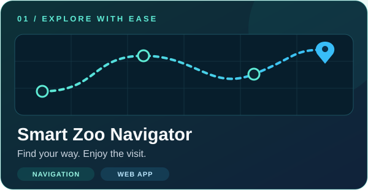
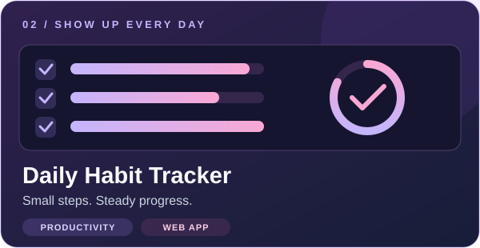
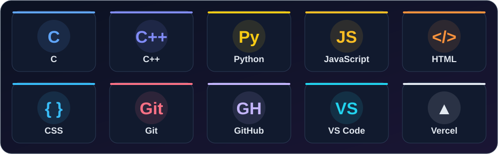

<!-- Visual assets live in assets/. Keep them alongside this README. -->

 

**Aspiring Full Stack Developer · BCA @ PSIT, Kanpur · Class of 2028**

Small ideas. Useful products. A little better every day.

[Explore my work](#selected-work) &nbsp; / &nbsp; [My toolkit](#toolkit) &nbsp; / &nbsp; [Say hello](#lets-connect)

---

### 👋 A little about me

I'm **Sidharth**, a second-year BCA student who learns by building. I enjoy taking everyday problems and turning them into web experiences that feel simple to use—from navigating a zoo to keeping a daily habit going.

I'm strengthening my programming fundamentals, exploring the full stack, and looking for opportunities to learn alongside people who care about what they build.

| Right now | On my radar |
| :--- | :--- |
| Building practical web projects | Internships and beginner-friendly collaborations |
| Sharpening C, C++, Python and JavaScript fundamentals | Data structures, algorithms and full stack development |
| Studying at PSIT in Kanpur, India | Graduating in 2028 |

 

## Selected work

### 🧭 Smart Zoo Navigator

  

**Find your way. Enjoy the visit.** A web app that helps visitors pick a zoo and explore its animals, paths and facilities through an interactive map.

- Zoo selection as the starting point
- Interactive map and simple navigation
- Mobile-friendly layout with bottom navigation

**[Open live demo ↗](https://myzoo-navigator.vercel.app)** &nbsp; · &nbsp; [View source](https://github.com/urfavsidhu/myzoo-navigator)

 

### ✨ Daily Habit Tracker

  

**Small steps. Steady progress.** A simple habit tracking app for building a daily routine, marking habits complete and keeping a streak going.

- Daily habits in one place
- Clear, distraction-free interface
- Works on mobile and desktop

**[Open live demo ↗](https://daily-habit-tracker-teal-three.vercel.app)**

  <a href="https://github.com/urfavsidhu?tab=repositories"><strong>Explore all repositories →</strong></a>

 

## Toolkit

The tools I'm learning and using as I build.

| Area | Technologies |
| :--- | :--- |
| **Programming** | C · C++ · Python · JavaScript |
| **Web fundamentals** | HTML · CSS · JavaScript |
| **Development workflow** | Git · GitHub · Visual Studio Code |
| **Deployment** | Vercel |

 

## 🎯 What I'm working toward

- [x] Launch my first live projects
- [ ] Complete 100 Days of Code
- [ ] Build more full stack projects
- [ ] Strengthen my data structures and algorithms skills
- [ ] Make my first open source contribution

 

## 🐍 One contribution at a time

Learning, building and showing up consistently.

<picture>
  <source media="(prefers-color-scheme: dark)" srcset="https://raw.githubusercontent.com/urfavsidhu/urfavsidhu/output/github-snake-dark.svg" />
  <source media="(prefers-color-scheme: light)" srcset="https://raw.githubusercontent.com/urfavsidhu/urfavsidhu/output/github-snake.svg" />
  
</picture>

Updated by the repository's Generate Snake Animation workflow.

 

## Let's connect

Have an internship opportunity, a project idea, or something I can learn from? I'd love to hear from you.

  
  
  
  
  

---

**Build something useful. Learn something new. Keep going.**

Sidharth Sharma · Kanpur, India

